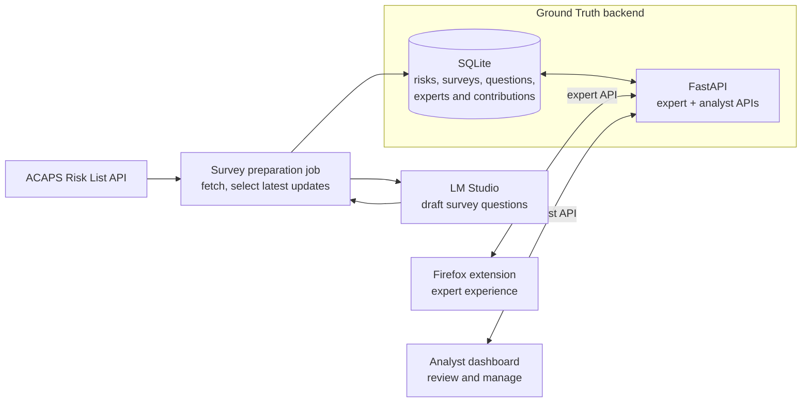
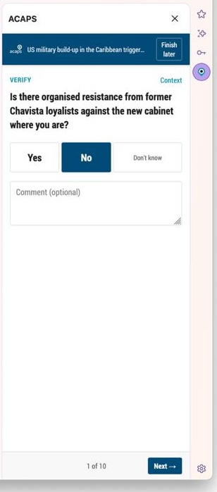
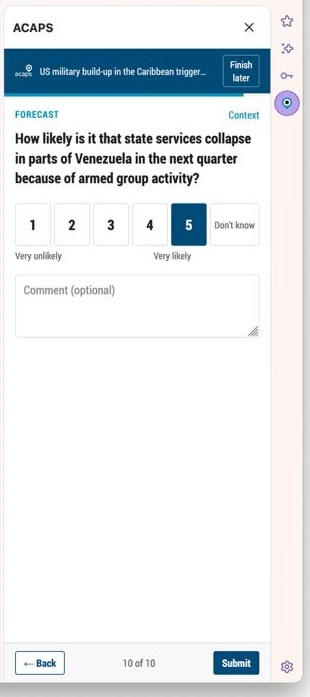
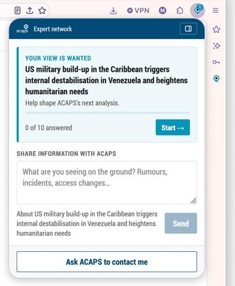
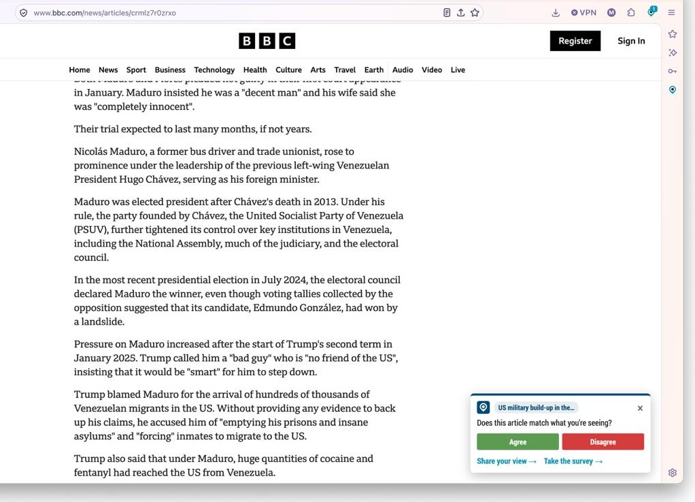
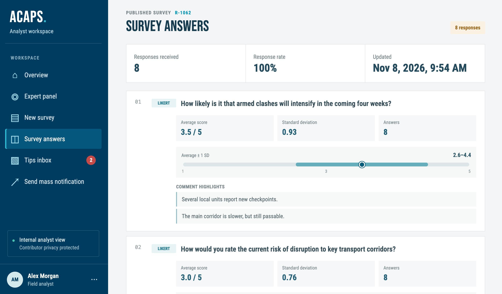
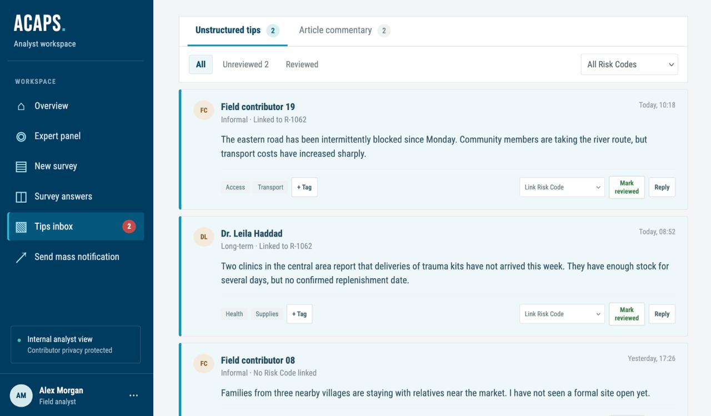
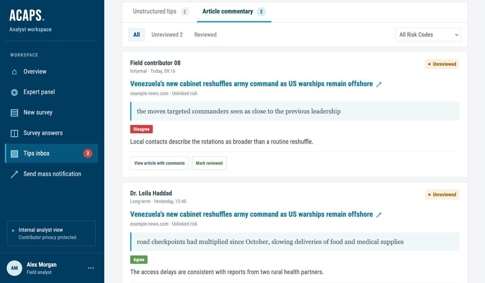

# Ground Truth

Ground Truth is a prototype built for Hackathon for Good #8 in response to the ACAPS challenge. It helps ACAPS keep in touch with humanitarian experts between risk-report updates, gather local observations, and understand whether published risk assessments reflect what people are seeing on the ground.

## Challenge context

ACAPS is an independent humanitarian analysis organisation that monitors more than 100 crises around the world. Its analysts use public sources and expert conversations to create the ACAPS Risk List: risks that could trigger a new crisis or sharply worsen humanitarian needs. Each risk is assessed for likelihood and expected humanitarian impact.

After an assessment is published, ACAPS has limited visibility into whether people closest to a crisis recognise the situation described or see new developments. Ground Truth provides lightweight ways for experts to share that perspective, and for analysts to review and act on it.

## Our solution

The prototype connects three parts of the feedback loop:

- **Firefox extension for experts:** experts join with an invite code, answer short surveys one question at a time, share optional free-text tips, and send feedback on relevant news articles. The extension supports an expert's chosen anonymity level and avoids attributing contributions publicly.
- **Analyst dashboard:** analysts select a risk, onboard and manage experts, review and edit drafted surveys before publishing, view incoming tips and article comments, and queue notifications.
- **Backend:** a FastAPI service provides the expert and analyst APIs. A survey-preparation job fetches ACAPS risk information, uses an LLM to draft questions, and stores surveys and individual questions in SQLite. Analysts remain in the publishing loop.

### Architecture



### Three channels for expert input

The Firefox extension gives experts three complementary ways to share what they know:

1. **Recurring surveys:** When new information is published for an ACAPS risk, the backend prepares an updated set of short yes/no and 1–5 scale questions based on the latest assessment. Analysts review, edit and publish each survey, making sure that every interaction with experts has a human touch, and that analysts stay in control of the feedback loop. Experts can answer questions one at a time, skip any they cannot answer, and add optional comments.

<table>
  <tr>
    <td align="center"></td>
    <td align="center"></td>
  </tr>
  <tr>
    <td align="center">Binary survey question</td>
    <td align="center">Likert scale survey question</td>
  </tr>
</table>

2. **Open text tips:** A free-text box lets experts send any relevant information they have, even when it does not fit a survey question or relate to a specific article.

<table>
  <tr>
    <td align="center"></td>
  </tr>
  <tr>
    <td align="center">Free text tip</td>
  </tr>
</table>

3. **Contextual article comments:** When an article matches a risk the expert follows, they can respond to the article or highlight a passage and comment on it. The submission is saved with the article link and highlighted context so analysts can understand what the expert is responding to.

<table>
  <tr>
    <td align="center"></td>
    <td align="center"></td>
  </tr>
  <tr>
    <td align="center">General article feedback</td>
    <td align="center">Line-specific comment</td>
  </tr>
</table>

Analysts invite experts and manage the panel in the dashboard, review and edit drafted surveys before publishing, and triage incoming tips and article comments. Experts choose their anonymity settings when they join. Analysts can also queue notifications for a selected risk and audience.

<table>
  <tr>
    <td align="center"></td>
    <td align="center"></td>
    <td align="center"></td>
  </tr>
  <tr>
    <td align="center">Survey answers</td>
    <td align="center">Open text tips</td>
    <td align="center">Article comments</td>
  </tr>
</table>

Survey questions are stored both as a complete survey payload and as individual `survey_questions` rows, which can be queried by `risk_id` and `based_on_update`. Expert-facing routes are documented in [`backend/openapi.yaml`](backend/openapi.yaml); implementation and data-flow details are in [`backend/ARCHITECTURE.md`](backend/ARCHITECTURE.md).

## Run the demo locally

The quickest path is Docker Compose. From the repository root:

```bash
docker compose -f docker/docker-compose.yml up -d --build
docker compose -f docker/docker-compose.yml exec api python seed_demo.py
```

The seed command creates a demo panel and survey without requiring ACAPS credentials or an LLM, and prints the invite code (`DEMO1`). Open the analyst dashboard at <http://localhost:8080>.

To load the extension and join the demo panel:

1. In Firefox, open <about:debugging#/runtime/this-firefox>.
2. Click **Load Temporary Add-on…** and select `extension/manifest.json`. A welcome tab opens.
3. Open <http://localhost:8000/join?code=DEMO1>, or enter `DEMO1` in the welcome tab, then click **This is me, continue**.

To try article matching and commenting, serve the included test article from the repository root:

```bash
python3 -m http.server 8766 --directory extension/dev
```

Open <http://localhost:8766/article.html>. The extension should show an article prompt; select text in the article to try the Agree / Disagree / Comment bar.

The SQLite database is stored in the `groundtruth-data` Docker volume. To remove the demo experts and their answers while keeping the database, run:

```bash
docker compose -f docker/docker-compose.yml exec api python seed_demo.py --reset
```

See [`extension/README.md`](extension/README.md) for detailed extension setup and test instructions. To run the live survey-preparation job instead of using the seeded demo survey, configure ACAPS API credentials and LM Studio settings in `.env`, then run `python daily_job.py` inside the API container.

## Current prototype scope

- The survey job is currently configured for the demo risk `R1011`.
- Article matching currently relies on the risk ID or exact risk title in the article text.
- Notifications and contact/email follow-up are prototype workflows; external delivery is not configured.
- The analyst API requires `ANALYST_API_KEY`. Keep credentials in local environment configuration and do not commit them.

## Repository

- [`backend/`](backend/): FastAPI service, ACAPS client, survey job, and SQLite persistence.
- [`analyst-dashboard/`](analyst-dashboard/): analyst web application.
- [`extension/`](extension/): Firefox extension for experts.
- [`docker/`](docker/): local multi-service Docker Compose setup.
