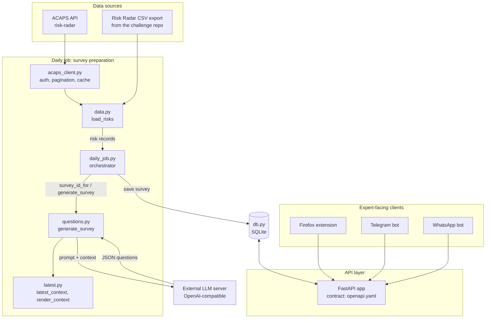

# Ground Truth backend: architecture overview

Backend for a moderated expert loop around ACAPS risk analyses (Hackathon for Good #8). Experts react to the latest risk updates through short surveys, via a Firefox extension (primary), a Telegram bot and a WhatsApp bot. Each expert controls their own anonymity level, and nothing is ever attributed publicly.

Requirements: `SPEC_1.md`. API contract: `openapi.yaml`.

## Architecture



## Files

| File | Role | Notes | Owner |
|---|---|---|---|
| `acaps_client.py` | Talks to the ACAPS API: token auth (`/api/v1/token-auth/`), pagination, rate limiting (60 requests/min), JSON cache in `.cache/` | Cache key includes the filters; `use_cache=False` forces a fresh fetch | |
| `data.py` | Single loader for risks: API first, CSV fills the gaps (R1043 only exists in the CSV). Drops drafts (under development) | Both sources produce the same record shape | |
| `latest.py` | Turns a risk into a compact LLM context: 3 most recent updates, or rationale + updates if there are fewer than 3. Strips citation links | `render_context` produces the text | |
| `questions.py` | Prompt, LLM call, JSON extraction/validation, retries. Assigns question IDs (`L1`-`L5`, `B1`-`B5`) and `survey_id`. Returns a `Survey` matching the OpenAPI schema | Token budget: 3 updates, falls back to 1 | |
| `db.py` | SQLite storage: `groups`, `experts`, `surveys`, `responses` | Expert tokens are stored hashed | |
| `daily_job.py` | Orchestrator. For each risk a group tracks: skip if the survey for the latest update exists, skip closed risks, otherwise generate and save | One failing risk does not stop the others | |
| FastAPI app (`_file name_`) | Serves the endpoints below from the database | | |
| `openapi.yaml` | API contract | Assumptions are marked in the file | |
| `SPEC_1.md` | Team requirements | | |

## Data flow

### 1. Daily job (survey preparation)

1. `data.load_risks(use_cache=False)` fetches all risks from the ACAPS API and fills in any the API does not serve from the CSV.
2. For each risk that at least one group tracks, `questions.survey_id_for(risk)` computes `<risk_id>_<yyyy-mm-dd of newest update>` without calling the LLM.
3. If that survey already exists, the job skips it. Closed risks (`Materialised`, `Not materialised`) and risks missing from the data are skipped too.
4. Otherwise `generate_survey(risk)` builds the context (`latest.py`), calls the LLM, validates the JSON (retries up to twice), and returns a `Survey`.
5. `db.save_survey` stores it. `--force` regenerates, but refuses when experts have already answered that survey.

### 2. Expert flow (API)

1. A group is created for a `risk_id` and returns an invite code. The expert registers with it and picks an anonymity level, then receives a bearer token.
2. The client calls `GET /experts/{expert_id}/surveys/current`. The API finds the expert's group and its risk, then returns the latest survey, or `204` if there is none or the expert has already submitted answers for it.
3. Answers are saved with `PUT /experts/{expert_id}/surveys/{survey_id}/responses` (draft or submitted). A skipped question is `null`. If a newer update has superseded the survey, the API returns `409`.
4. Free-form input goes to `POST /notes`. Articles are checked against tracked risks with `POST /articles/match` and commented on with `POST /articles/comments`.

## API endpoints

| Method and path | Purpose |
|---|---|
| `POST /groups` | Create a group linked to a `risk_id` (analyst key) |
| `POST /experts` | Register an expert with an invite code, choose anonymity level, receive a token |
| `PATCH /experts/me` | Change anonymity level, language or channel |
| `GET /experts/{expert_id}/surveys/current` | Outstanding survey, or `204` |
| `PUT /experts/{expert_id}/surveys/{survey_id}/responses` | Save answers (draft or submitted) |
| `POST /notes` | Unstructured input |
| `POST /articles/match` | Does an article relate to a tracked risk? |
| `POST /articles/comments` | Comment on a matched article |

## Design decisions

- **Both data sources produce the same record shape.** Nothing downstream knows whether a risk came from the API or the CSV.
- **Surveys are keyed by `(risk_id, newest update date)`.** This gives generate-once-per-update, the "already answered?" check, and the `409` on stale answers.
- **Question IDs are assigned in code, not by the LLM.** Answers refer to them, so the model never sees or invents them.
- **The LLM only sees public ACAPS text**, never expert input.
- **Anonymity is part of the data model.** There are three levels (`known_to_acaps`, `pseudonymous_to_peers`, `fully_anonymous`). Contributions are never attributed publicly at any level.
- **Authentication:** bearer token issued at registration, checked against the `expert_id` in the path. Analysts use an `X-Analyst-Key` header.

## Configuration (`.env`)

| Variable | Used by | Notes |
|---|---|---|
| `ACAPS_EMAIL`, `ACAPS_PASSWORD` | `acaps_client.py` | Registered ACAPS API account |
| `LLM_BASE_URL`, `LLM_MODEL` | `questions.py` | LM Studio v1 API base URL (for example `http://localhost:1234/api/v1`) and model name. Calls `/chat` with `input`, `context_length`, reasoning disabled, and `temperature`. |
| `LLM_API_KEY` | `questions.py` | Optional |
| `CSV_PATH` | `data.py` | Defaults to `risk-radar-export.csv` next to the script |
| `DB_PATH` | `db.py` | Defaults to `groundtruth.db` next to the script |

Never commit `.env` or `.cache/`.

## Running it

```bash
pip install requests python-dotenv pydantic fastapi uvicorn

# generate surveys
python daily_job.py --risk R1043     # one risk, no group needed (demo)
python daily_job.py                  # every risk a registered group tracks
python daily_job.py --force          # regenerate existing surveys

# start the API
uvicorn <module>:app                 # entry point:
```

## Open questions

- **Article matching.** How `POST /articles/match` decides that an article relates to a risk (keywords, embeddings, or the LLM):
- **Analyst moderation view.** How analysts see expert answers, agreement and disagreement, and where the "super estimator" scoreboard would live:
- **Group creation by experts.** Currently analysts only. Self-registered groups would need an approval step:
- **Closed risks.** Experts in a group whose risk has resolved get `204` from then on. Keep, or keep surveying:
- **LLM model and hosting:**
- **Deployment and scheduling** of the daily job and the API:
- **French and other languages** for questions and the interface:
- **Low-bandwidth and mobile behaviour:**
- **Pilot data.** Synthetic experts only until the pilot, per the challenge brief:
